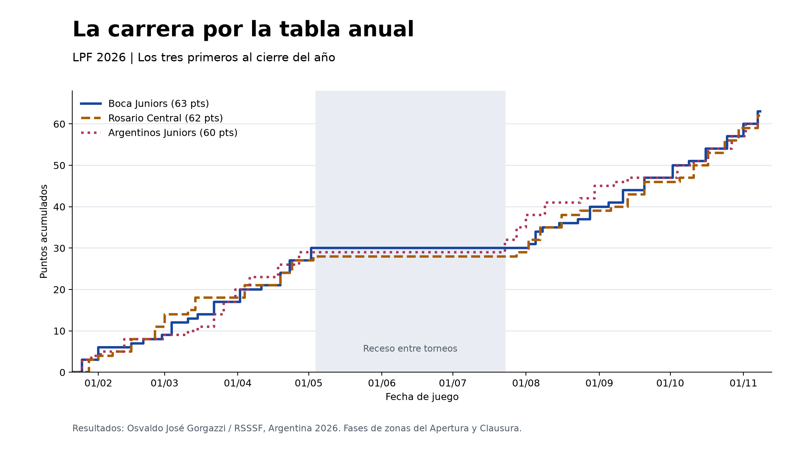
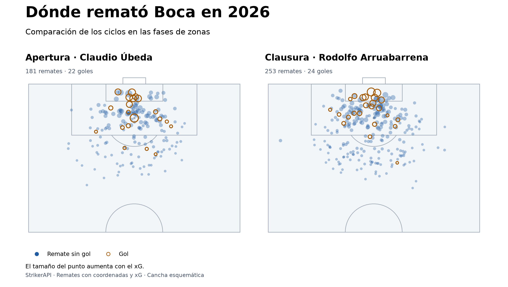
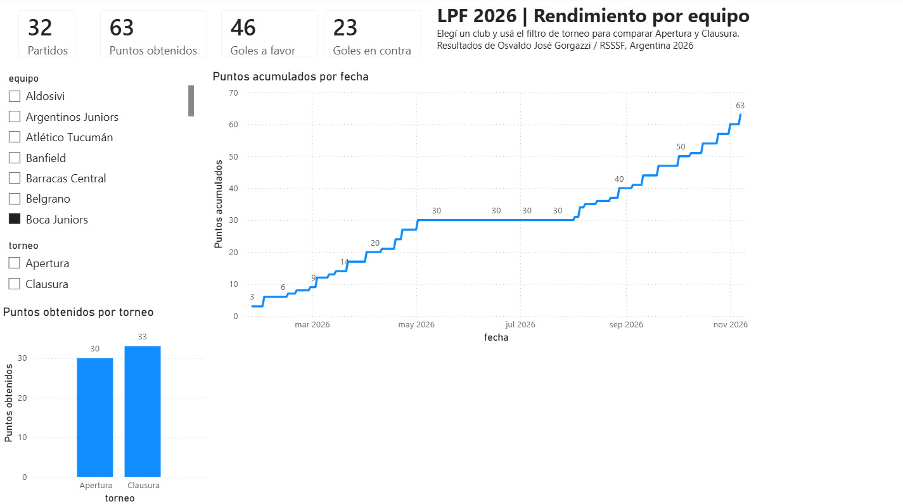

# LPF 2026 | Radiografía del fútbol argentino

Análisis de los **30 equipos** de la Liga Profesional Argentina 2026 a partir de **480 partidos** de las fases de zonas del Apertura y el Clausura.

## ¿Qué cambió entre los dos ciclos del Boca que ganó la tabla anual?

Boca terminó primero con **63 puntos**. Sumó 30 en el Apertura con Claudio Úbeda y 33 en el Clausura con Rodolfo Arruabarrena. De local pasó de **14 a 22 puntos** y de visitante, de **16 a 11**.

## Explorá el proyecto

- Cómo evolucionó la pelea por la tabla anual. [Gráfico de puntos del top 3](reports/evolucion_puntos_top3_2026.png)
- Cómo cambiaron los resultados de los 30 equipos entre torneos. [Comparación Apertura y Clausura](notebooks/02_apertura_vs_clausura_2026.ipynb)
- Cómo cambiaron las formaciones, los remates y los puntos esperados de Boca. [Informe de los dos ciclos](notebooks/01_boca_ciclos_2026.ipynb)
- Qué equipos tuvieron perfiles de rendimiento similares. [Análisis de clustering](notebooks/03_clustering_equipos_2026.ipynb)
- Cómo consultar los resultados en Power BI. [Guía del dashboard](powerbi/README.md)

## Criterios de trabajo

- Usar exclusivamente datos públicos o autorizados.
- Mantener independencia de los recursos privados del trabajo.
- Documentar fuentes, cobertura, permisos y decisiones metodológicas.
- Conservar los archivos originales sin editar.
- Validar los cálculos mediante tests.
- Registrar avances con issues y commits.
- No inventar datos ni métricas.

## Herramientas

Python, SQL, Jupyter Notebooks, Git, GitHub y Power BI.
Entorno local: Windows, VS Code y PowerShell.

## Estado

La base local contiene 480 partidos de zonas, 240 por torneo. Los balances de los 30 equipos coinciden con la tabla anual de Cómo Salió.

Balance agregado de Boca comprobado desde los marcadores.

Pasaron 46 pruebas automatizadas, 35 unitarias y 11 sobre archivos reales.

Los 32 partidos de Boca coinciden con la referencia de AFA en rivales, localía y marcadores. El playoff contra Huracán está excluido.

Los 480 partidos coinciden con RSSSF en jornada, localía, fecha de juego y marcador.

El [notebook de Boca](notebooks/01_boca_ciclos_2026.ipynb) compara los 16 partidos de zonas de cada ciclo. Boca pasó de 30 a 33 puntos. Sumó 8 puntos más de local y 5 menos de visitante.

Los 30 puestos de la tabla anual coinciden con RSSSF. Para el empate entre Independiente y Defensa y Justicia, el cálculo incorpora el orden publicado por RSSSF según el criterio de Fair Play.

Ver [fuentes y trazabilidad](docs/fuentes.md).

## Evolución de puntos

El gráfico sigue a los tres primeros de la tabla anual. Cada equipo suma sus puntos el día en que disputó el partido, incluso cuando se reprogramó la jornada. El [script de generación](reports/generar_evolucion_puntos_top3.py) permite repetir el cálculo y regenerar el PNG.

## Apertura vs. Clausura

El [notebook de comparación](notebooks/02_apertura_vs_clausura_2026.ipynb) reúne los puntos y goles de los 30 equipos en ambos torneos. El [gráfico de cambios en puntos](reports/apertura_vs_clausura_2026.png) muestra que Instituto registró la mayor suba (+13) y Estudiantes de La Plata la mayor caída (−15).

## Resultados en SQL

La base SQLite se genera a partir de los 480 partidos validados. La [consulta de balance anual](sql/02_balance_anual.sql) recalcula los resultados de los 30 clubes y una prueba confirma que coinciden con pandas. La [guía del entorno](docs/entorno.md#base-sqlite) explica cómo reconstruir la base y ejecutar el control.

## xG y xGA de Boca

El [notebook de ciclos](notebooks/01_boca_ciclos_2026.ipynb) compara los 32 partidos de zonas de Boca. Del Apertura al Clausura, el xG registrado pasó de **20,58 a 24,82** y el xGA registrado pasó de **12,40 a 14,63**.

Los valores se calculan sobre los remates con xG disponible en StrikerAPI. [Cobertura y método de cálculo](docs/fuentes.md#cobertura-de-strikerapi-para-boca)

Con los remates registrados, el modelo estimó **57,30 puntos esperados (xPTS)** para Boca, frente a **63 puntos reales**. El notebook muestra el cálculo y la comparación por ciclo.

El perfil de remate por jugador compara el xG total y el npxG, que excluye los penales. Miguel Merentiel lideró a Boca con **8,46 npxG en 54 remates sin penal**.

Entre los 25 jugadores de Boca con al menos 450 minutos en las fases de zonas, **Adam Bareiro** lideró en npxG por 90 con **0,483**, seguido por **Miguel Merentiel** con **0,436**. Merentiel lideró el acumulado con **8,455 npxG en 1.746 minutos**. [Ranking por jugador](notebooks/01_boca_ciclos_2026.ipynb)

El notebook compara las formaciones iniciales de los 32 partidos de Boca. En el Apertura aparecieron **siete esquemas** y en el Clausura, **tres**. El **4-3-3** y el **4-2-3-1** sumaron 15 de los 16 partidos del Clausura. [Fuente y cobertura](docs/fuentes.md#formaciones-iniciales-de-boca)

## Agrupamiento de equipos

El [notebook de clustering](notebooks/03_clustering_equipos_2026.ipynb) agrupa los 30 clubes por goles a favor por partido, goles en contra por partido y proporción de empates. Se compararon de dos a seis grupos con el coeficiente de silueta y la estabilidad en submuestras. Se eligieron tres grupos por su mayor estabilidad mediana y para facilitar la interpretación.

Boca quedó en el grupo que promedió menos goles recibidos por partido y una mayor proporción de empates.

## Power BI

El informe incluye **Rendimiento por equipo**, con filtros por club y torneo, indicadores y evolución de puntos, y **Tabla anual**, con la clasificación de los 30 clubes.

El informe se abre en Power BI Desktop con los datos ya importados. [Descargar LPF_2026.pbix](https://github.com/PepiGercek/argentina-football-analytics-2026/releases/download/v0.1.0/LPF_2026.pbix)

La [guía de Power BI](powerbi/README.md) explica cómo exportar los datos desde SQLite, relacionar las tablas y recrear las medidas DAX del informe.

 
## Entorno de desarrollo

La [guía del entorno](docs/entorno.md) describe la configuración en Windows y los pasos para reproducirla.

Las versiones de las dependencias están registradas en [requirements.txt](requirements.txt).

El CSV de los 480 partidos se puede reconstruir a partir del HTML público de RSSSF. [Pasos para reconstruir el CSV](docs/entorno.md#reconstruir-el-csv-de-resultados)